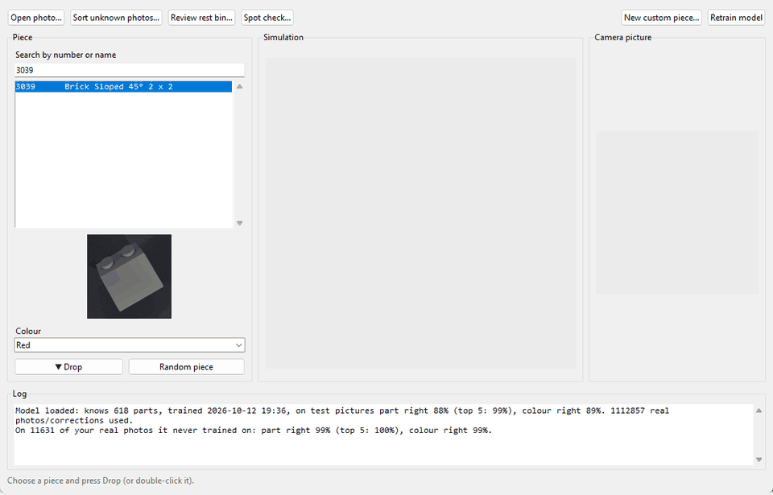
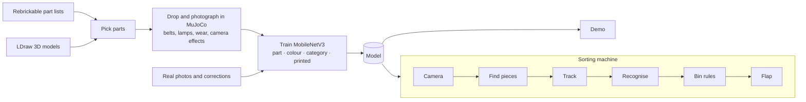

# BrickSort

Recognises LEGO parts from a camera picture and sorts them on a simulated conveyor belt.



## What it does

1. **Picks the parts to learn:** about 600 of the most common LEGO parts, from Rebrickable's part
   lists, with the 3D models from the LDraw parts library.
2. **Makes training pictures with physics:** each part is dropped into a MuJoCo scene and photographed,
   with random lamps, surfaces, wear, blur and noise. Half of the pictures copy the sorting machine:
   its belt, lamps and camera height (all set in *Machine setup*).
3. **Mixes in real photos:** your own, corrections made in the app, and public datasets.
4. **Trains one network with four answers:** a MobileNetV3 that says which part, which colour, which
   category, and whether the piece is printed.
5. **Demo:** drop a piece, see the top 5 guesses as 3D pieces you can spin, correct them; the
   corrections are used in the next training.
6. **Virtual sorting machine:** a camera above a moving belt finds each piece, tracks it, photographs it
   once as it crosses the middle, and a flap sends it to a bin chosen by your rules.
   `bricksort/sorter/hardware.py` defines the camera, belt and flap interfaces a real machine plugs
   into; the sorting logic can't tell the simulation from real hardware.

## Results

Evaluation in progress: a test on photos of pieces the model has never seen, drawn at random from a
mixed tub. (The number the training prints, measured on held-back dataset photos, is optimistic:
those photos come from the same sessions and the same physical bricks as the training photos.)

## How it works



## Quick start (Windows)

```bash
git clone https://github.com/tobiaswahlund/BrickSort.git
```

1. Double-click `scripts/windows/setup.bat` (installs Python, PyTorch and MuJoCo, downloads the part library).
2. Download the trained model, `lego_model.pt`, from the [Releases](../../releases) page into `model/`.
3. Double-click `scripts/windows/Start demo.bat` or `Start sorting machine.bat`.

Everything else, including training your own model, is in [docs/USAGE.md](docs/USAGE.md), and every
window is shown with what each button does in [docs/WINDOWS.md](docs/WINDOWS.md).

## Hard problems and decisions

- **Simulated pictures that work on real photos.** Pieces are dropped with physics, so they land the
  way real pieces do. The training pictures copy the machine's camera (the same pixels per mm), its
  belt and its lamps, and the plastic's shine is fitted to real photos (highlights cover 8.7% of a piece
  in the photos, 8.9% in the renders). Colour jitter is kept gentle, so colours stay learnable.
- **Left and right parts.** Pictures are never mirrored: a mirrored left wing is a right wing.
- **Look-alike colours.** Light Gray and Light Bluish Gray (and a few other pairs) are counted as one
  colour, because they can't be told apart on camera.
- **Pieces stuck together.** A piece bigger than its guessed part could be, or several objects too close
  for the flap to separate, goes to the rest bin rather than a wrong bin.
- **One piece, one photo.** Dark pieces on a dark belt, and tall pieces like arches, used to look like two
  or three objects and were photographed several times (about 1 in 10 pieces). A piece is now
  photographed only as it crosses the middle line, and everything too close to separate is decided
  together: in 600+ test pieces each got exactly one photo.
- **Safe by default.** Anything the model isn't sure enough about goes to the rest bin; each bin can ask
  for its own confidence.

## Limitations and roadmap

- The sorting machine is simulated so far. The hardware interface is ready; a real webcam, belt,
  servo flap and Arduino are next.
- About 600 parts. Rarer parts are only recognised by category.
- The launchers are Windows-only; the Python commands work elsewhere too.
- The honest accuracy test (above) is still to come.

## Credits

- 3D models: [The LDraw Parts Library](https://www.ldraw.org), CC BY 2.0 / CC BY 4.0.
- Part, colour and set data: [Rebrickable](https://rebrickable.com/downloads/).
- Photos: "Images of LEGO bricks" (Gdańsk University of Technology,
  [doi:10.34808/arsb-4268](https://doi.org/10.34808/arsb-4268)), CC BY 4.0, and "LEGO bricks for
  training classification network" (Gdańsk University of Technology).
- Scenes of many pieces: "B200 LEGO Detection Dataset" (Kaggle), CC BY-SA 4.0.
- Physics and rendering: [MuJoCo](https://mujoco.org). Network: PyTorch / torchvision.

Built with [Claude Code](https://claude.com/claude-code) as a pair programmer.

LEGO® is a trademark of the LEGO Group of companies which does not sponsor, authorize or endorse this
site. BrickSort is an independent project.

## Licence

The code is MIT-licensed (see [LICENSE](LICENSE)). The trained model (the Release download) is
licensed CC BY-SA 4.0, because part of its training data is CC BY-SA 4.0. The datasets and the 3D
part library keep their own licences, listed above.
