# The windows

Every window of BrickSort, with a number on each button and control. Made by
`scripts/make_screenshots.py`; run it again after changing a window.

## Demo

Drop a piece in the virtual world and check the model's guesses (Start demo.bat).

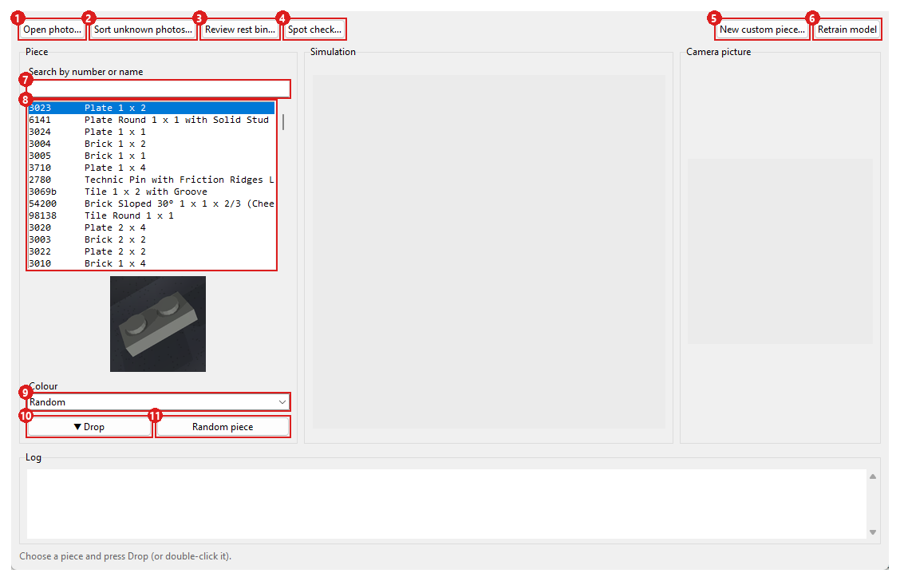

1. **Open photo…**: Check any photo: the model guesses the part and colour, and you can correct it.
2. **Sort unknown photos…**: Go through the photos in my_photos/unknown/; choosing the part files each one.
3. **Review rest bin…**: Look at what the sorting machine set aside and say what each piece was.
4. **Spot check…**: Check pieces the machine did sort (least sure first): a real-world accuracy score.
5. **New custom piece…**: Add a piece Rebrickable doesn't have (your own number, name, category, tags).
6. **Retrain model**: Make pictures of any new parts and train a few rounds with your corrections.
7. **Search by number or name**: Type to filter the list of parts.
8. The parts the model knows. Double-click one to drop it.
9. **Colour**: The colour to drop it in (Random: one this part really comes in).
10. **▼ Drop**: Drop the chosen piece onto the tray; the camera photographs it and the model guesses.
11. **Random piece**: Pick a random part and drop it.

## Check the guess

Opens after a drop or a photo: the model's colour and part guesses.

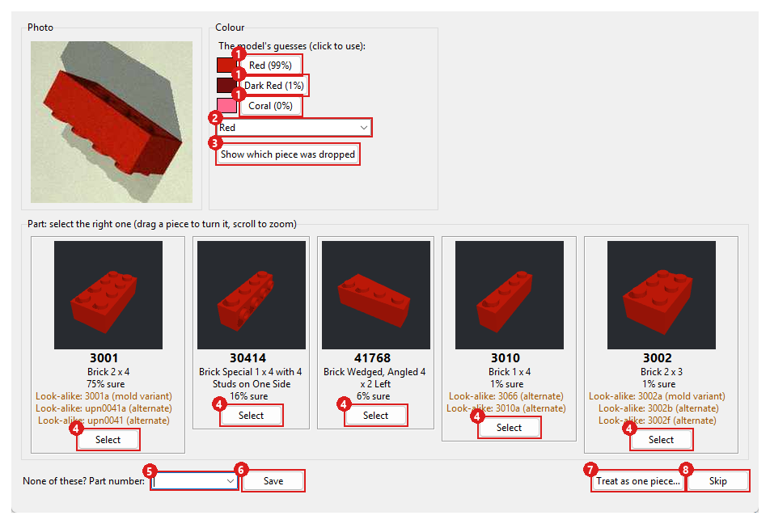

1. One of the model's colour guesses: click to use it.
2. The colour to save the picture under (type to search).
3. **Show which piece was dropped**: Reveal the right answer (in the demo it's known).
4. **Select**: This is the right part: save the picture with it (and the colour above).
5. **None of these? Part number**: Type the right part number if none of the guesses is right.
6. **Save**: Save with the typed part number.
7. **Treat as one piece…**: Several parts that belong together (like a hinge): learn them as one piece.
8. **Skip**: Close without saving anything.

## Sorting machine

The virtual conveyor belt (Start sorting machine.bat).

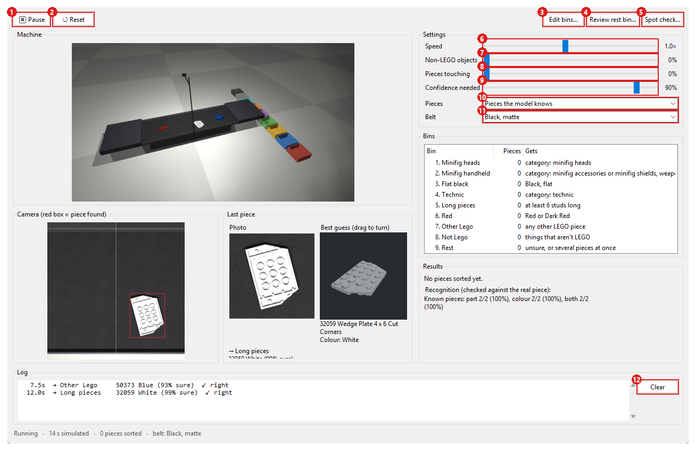

1. **⏸ Pause**: Stop now; Start carries on where it stopped.
2. **↺ Reset**: Empty the belt and the bins and start counting again.
3. **Edit bins…**: Change which pieces go into which bin.
4. **Review rest bin…**: Look at what the sorting machine set aside and say what each piece was.
5. **Spot check…**: Check pieces the machine did sort (least sure first): a real-world accuracy score.
6. **Speed**: How fast the simulation runs.
7. **Non-LEGO objects**: How often something that isn't LEGO comes along the belt.
8. **Pieces touching**: How often a piece is dropped onto another one.
9. **Confidence needed**: How sure the model must be; less sure pieces go to the rest bin.
10. **Pieces**: Which pieces ride the belt: the ones the model knows, all LEGO parts, or ones you choose.
11. **Belt**: The belt's look (also set in Model training > Machine setup).
12. **Clear**: Empty the log.

## Edit bins

From the sorting machine: the bins and what goes into each.

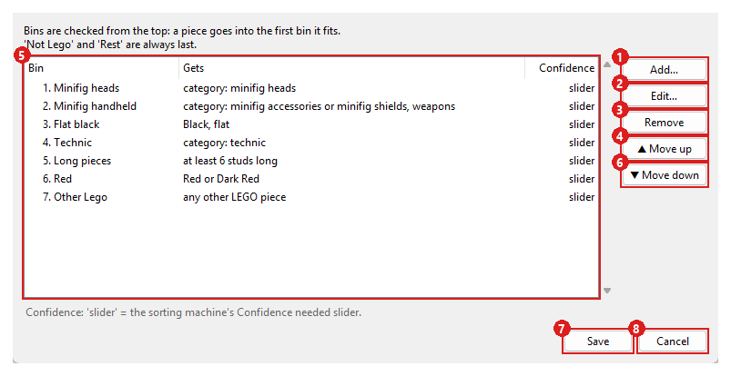

1. **Add…**: Add a bin below the selected one.
2. **Edit…**: Change the selected bin (or double-click it).
3. **Remove**: Remove the selected bin.
4. **▲ Move up**: Move the bin up: bins are checked from the top.
5. The bins, checked from the top: a piece goes into the first one it fits.
6. **▼ Move down**: Move the bin down.
7. **Save**: Save the bins; the sorting machine uses them right away.
8. **Cancel**: Close without saving.

## One bin

Adding or editing a bin: everything a piece must match.

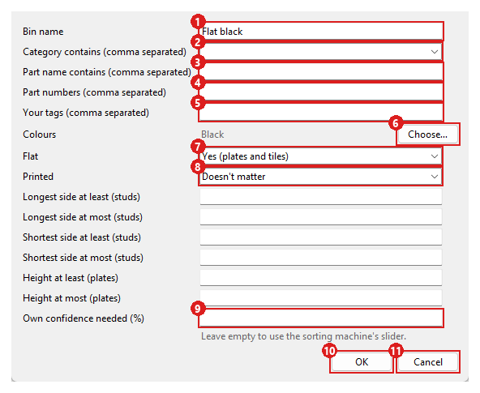

1. **Bin name**: The bin's name.
2. **Category contains (comma separated)**: Rebrickable categories this bin takes (part of the name is enough).
3. **Part name contains (comma separated)**: Words in the part's name, like slope.
4. **Part numbers (comma separated)**: Exact part numbers (look-alike versions count too).
5. **Your tags (comma separated)**: Tags of your own custom pieces.
6. **Choose…**: Pick colours in a list grouped by main colour.
7. **Flat**: Only plates and tiles, only other pieces, or either.
8. **Printed**: Only printed pieces, only plain ones, or either.
9. **Own confidence needed (%)**: A confidence just for this bin; empty = the sorting machine's slider.
10. **OK**: Keep the changes.
11. **Cancel**: Close without saving.

## Choose colours

From a bin: colours grouped by main colour.

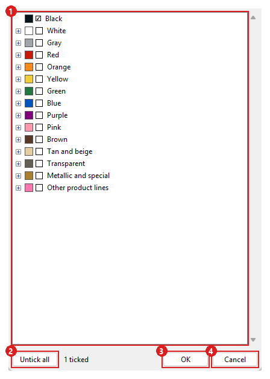

1. Tick colours; ticking a group ticks all of it. The arrow opens a group.
2. **Untick all**: Clear all ticks.
3. **OK**: Keep the changes.
4. **Cancel**: Close without saving.

## Choose the pieces for the belt

From the sorting machine's Pieces list.

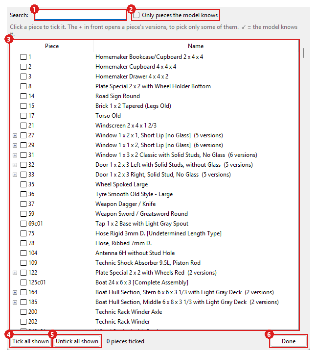

1. **Search**: Filter the list by number or name.
2. **Only pieces the model knows**: Hide parts the model hasn't learned.
3. Click a piece to tick it; the arrow opens a part's versions.
4. **Tick all shown**: Tick every piece in the list as it's filtered now.
5. **Untick all shown**: Untick every piece in the list as it's filtered now.
6. **Done**: Use the ticked pieces on the belt.

## Cut out pieces

One picture per piece from photos of several pieces (Cut out pieces.bat).

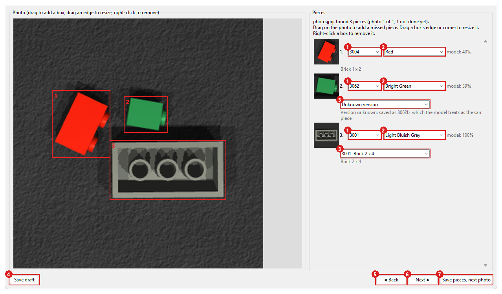

1. The piece's part number (the model's guess is filled in). Empty = skip this piece.
2. Its colour. Unknown sends it to Check colours.
3. For numbers with versions (3062a / 3062b): which one, or Unknown version.
4. **Save draft**: Keep the boxes and answers for this photo, to finish later.
5. **◀ Back**: The previous photo (this one's progress is kept).
6. **Next ▶**: The next photo (what you typed on this one is kept).
7. **Save pieces, next photo**: Save one picture per piece in my_photos/<part>/<colour>/, then the next photo.

## Check colours

Give photos their colour, piece by piece (Check colours.bat).

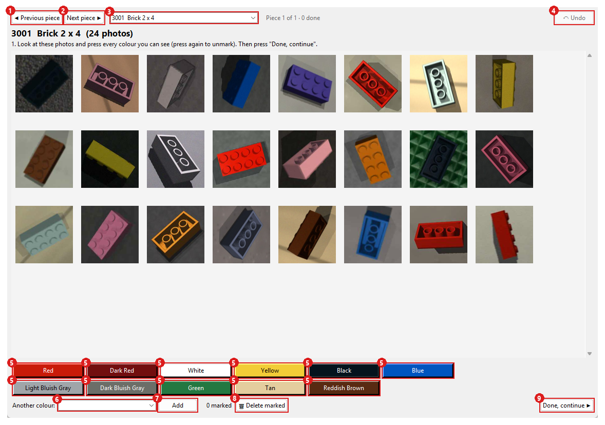

1. **◀ Previous piece**: The previous piece.
2. **Next piece ▶**: The next piece.
3. Jump to any piece (✓ = done).
4. **↶ Undo**: Take back the last step, photos moved back too (or Ctrl+Z).
5. A colour this piece could be: press every colour you can see in the photos.
6. **Another colour**: Add a colour that's missing from the buttons.
7. **Add**: Add the typed colour.
8. **🗑 Delete marked**: Throw away the marked photos (kept in _check/_deleted, so it can be undone).
9. **Done, continue ▶**: Go on to sorting the photos one colour at a time.

## Model training

Make training pictures and train the model (Model training.bat).

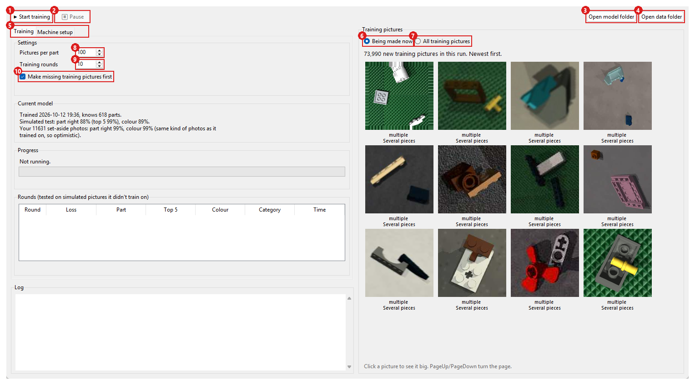

1. **▶ Start training**: Make missing training pictures, then train (Continue training after a pause).
2. **⏸ Pause**: Stop now; Start carries on where it stopped.
3. **Open model folder**: The folder with the model files (and backups of earlier models).
4. **Open data folder**: The folder with the training pictures and downloads.
5. Training: run it. Machine setup: make the pictures look like your machine.
6. **Being made now**: Show the newest training pictures of the current run.
7. **All training pictures**: Page through every picture the next training uses.
8. **Pictures per part**: How many training pictures each part gets.
9. **Training rounds**: How many rounds to train (each round saves its progress).
10. **Make missing training pictures first**: Make pictures for new parts before training.

## Model training: Machine setup

Make the training pictures look like your own machine.

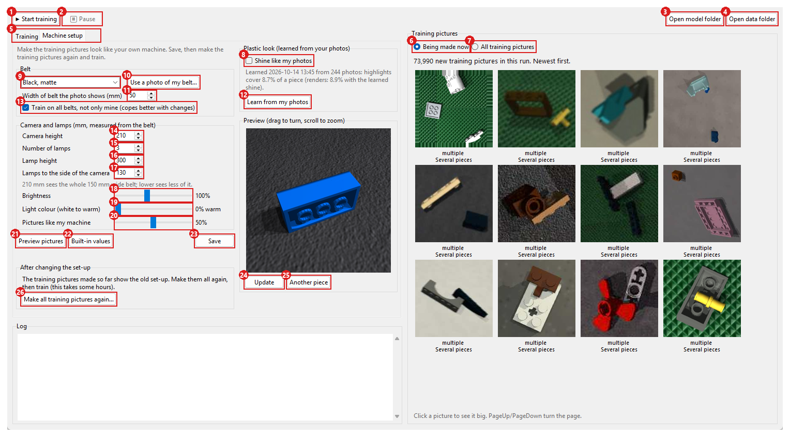

1. **▶ Start training**: Make missing training pictures, then train (Continue training after a pause).
2. **⏸ Pause**: Stop now; Start carries on where it stopped.
3. **Open model folder**: The folder with the model files (and backups of earlier models).
4. **Open data folder**: The folder with the training pictures and downloads.
5. Training: run it. Machine setup: make the pictures look like your machine.
6. **Being made now**: Show the newest training pictures of the current run.
7. **All training pictures**: Page through every picture the next training uses.
8. **Shine like my photos**: Give the plastic the shine measured on your real photos.
9. Your machine's belt: a built-in one or your own photo.
10. **Use a photo of my belt…**: Use a photo of your own belt, taken from straight above.
11. **Width of belt the photo shows (mm)**: How wide a piece of belt your photo shows, so pieces get the right size.
12. **Learn from my photos**: Measure the shine on your photos again (about a minute).
13. **Train on all belts, not only mine (copes better with changes)**: Train on every belt, or only yours.
14. **Camera height**: The camera lens's height above the belt, in mm.
15. **Number of lamps**: How many lamps light the belt.
16. **Lamp height**: The lamps' height above the belt, in mm.
17. **Lamps to the side of the camera**: How far to the side the lamps hang, in mm.
18. **Brightness**: How bright the lamps are.
19. **Light colour (white to warm)**: White daylight lamps or warm yellowish bulbs.
20. **Pictures like my machine**: How much of the training looks like your machine (the rest: tables, floors).
21. **Preview pictures**: Six pictures of a random piece with these settings, before saving.
22. **Built-in values**: Put every setting back to the built-in values.
23. **Save**: Save the machine setup (training pictures and the sorting machine use it).
24. **Update**: Redraw the 3D preview with the settings as they are now.
25. **Another piece**: Show another piece in the 3D preview.
26. **Make all training pictures again…**: Delete the training pictures so they're made again with the new setup.
